# Kaggle computer-vision benchmarks

Worked, reproducible solutions to Kaggle computer-vision competitions, trained **from scratch** (no pre-trained weights) and
evaluated with the competition's own metric where it can be computed offline. Each folder is self-contained: code, unit tests,
result tables, figures and a README with the method, the numbers and the caveats.

| Folder | Competition | Task | Metric |
|---|---|---|---|
| [`fathomnet-2023-out-of-sample/`](fathomnet-2023-out-of-sample/) | [FathomNet 2023 (FGVC10)](https://www.kaggle.com/competitions/fathomnet-out-of-sample-detection) | Multi-label recognition of 290 deep-sea animal categories and detection of images from a different depth range | mean of sAUC (out-of-sample detection) and MAP@20 |

## FathomNet 2023 in one page

**Problem.** 5,950 labelled images from 0-800 m depth; the evaluation images (10,744) come from 0-1300 m. A model must rank the
categories present in each image (MAP@20) and score how likely the image is out-of-sample (sAUC = 2 AUC - 1).

**Baseline.** 0.664 at the current Leaderboard

**What is in the data** (all from [`results/preprocess_meta.json`](fathomnet-2023-out-of-sample/results/preprocess_meta.json)):
only 133 of the 290 categories have any labelled image, 157 have none; 63 of the 133 have at most five images; images carry 1.51 labels
on average (70.7% have one); the most common category appears in 2,643 images.

**Pipeline.** One pre-processing stage (batched GPU JPEG decode, torchvision transforms v2 resizing to 448x256 and 224x128, channel
statistics from the training split only, a fixed split with six categories held out as "novel"), then three from-scratch methodologies
trained on identical inputs:

1. hand-crafted colour/gradient/texture features with a closed-form multi-output ridge model;
2. a residual CNN on 224x128 inputs, trained with GPU augmentation and a class-weighted binary cross-entropy;
3. a tile-MIL CNN that scores a 2x4 grid of tiles of the 448x256 image and pools tile logits with log-sum-exp.

**Validation results** ([`results/final_metrics.csv`](fathomnet-2023-out-of-sample/results/final_metrics.csv); 810 in-distribution and 550
novel validation images; sAUC uses 1 - max probability):

| Methodology | MAP@20 | sAUC (max-prob) | sAUC (energy) | sAUC (entropy) | Mean per-category AP | Parameters |
|---|---|---|---|---|---|---|
| 1 Classical features + ridge | **0.6167** | **0.2486** | 0.1348 | 0.2868 | 0.1044 | closed form |
| 2 Residual CNN, 224x128 | 0.6113 | 0.1773 | 0.0640 | 0.0932 | 0.1061 | 2.91 M |
| 3 Tile-MIL CNN, 448x256 | 0.5631 | 0.2439 | 0.1517 | -0.0796 | 0.0473 | 1.31 M |

**Correction (added after the out-of-sample round).** `proxy_score` in `results/final_metrics.csv` (0.4326 / 0.3943 / 0.4035) is
`0.5 (sAUC + MAP@20)` with MAP@20 taken on **seen images only**, so it overstates the competition score, which averages MAP@20 over every
image. Recomputed from the saved validation logits over all 1,360 validation images (seen and novel) the score is:

| Methodology | MAP@20 seen | MAP@20 novel | MAP@20 all images | sAUC (max-prob) | Score `0.5 (sAUC + MAP@20)` | Old `proxy_score` |
|---|---|---|---|---|---|---|
| 1 Classical features + ridge | 0.6160 | 0.1331 | 0.4207 | 0.2486 | **0.3347** | 0.4326 |
| 2 Residual CNN | 0.6113 | 0.1288 | 0.4162 | 0.1773 | **0.2967** | 0.3943 |
| 3 Tile-MIL CNN | 0.5631 | 0.1211 | 0.3843 | 0.2439 | **0.3141** | 0.4035 |

The seen-image MAP of the first model recomputes to 0.6160 (0.6167 was recorded). The new columns are in the CSV; the figure script of
this round does not produce them.

**Read this honestly.**
- The simplest model is competitive: on 4,590 training images with a very long tail, learned features add little to hand-crafted ones.
- Out-of-sample detection is weak for every method (best sAUC 0.29), and per-category average precision is about 0.10: most of the 133
  learnable categories are barely learned.
- The tile-MIL model reaches its best validation score at epoch 3 of 30 and does not improve afterwards.
- **No leaderboard score is reported.** The three prediction files were submitted, but Kaggle's scorer for this archived
  competition returned "Scoring session had non-zero exit code" for every file, including the competition's own unchanged
  `sample_submission.csv`, so the validation numbers above are the only measurements. They are a *proxy*: the novelty proxy
  (held-out categories) is not the depth shift of the real evaluation set.

## Visualizations

Six result figures and three that read the training statistics collected per epoch. Each caption names the file it comes from.

<table><tr><td colspan="2" align="center">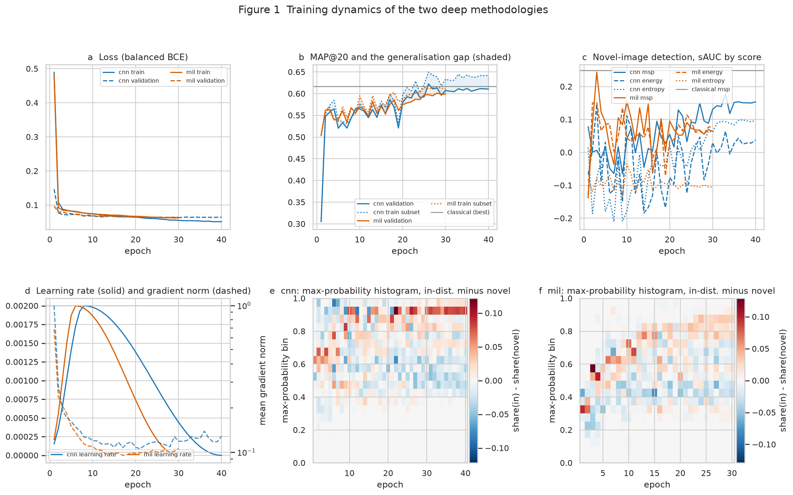<br><sub><b>Fig. 1</b> Loss, MAP@20 with the generalisation gap, novelty-detection sAUC, learning rate and gradient norm, and how the max-probability histograms of in-distribution and novel images separate. Source: <code>results/history/cnn_history.json</code>, <code>mil_history.json</code>.</sub></td></tr>
<tr><td colspan="2" align="center">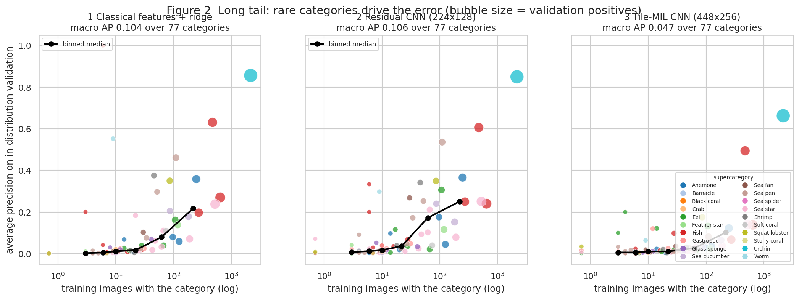<br><sub><b>Fig. 2</b> Per-category average precision against the number of training images (log scale). Source: per-category AP in <code>results/history/*.json</code> and <code>results/final_metrics.csv</code>.</sub></td></tr>
<tr><td width="50%">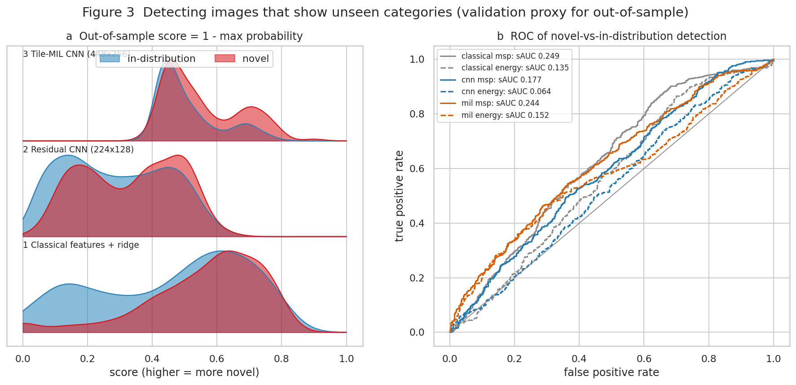<br><sub><b>Fig. 3</b> Distribution of the 1 - max-probability score for in-distribution and novel images, and ROC curves of the max-probability and energy scores.</sub></td>
<td width="50%">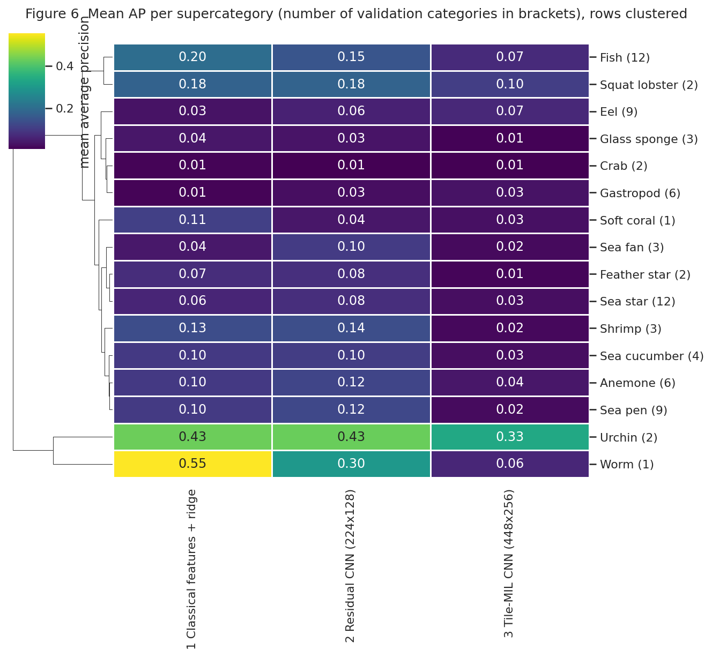<br><sub><b>Fig. 6</b> Mean average precision per supercategory and methodology, rows clustered.</sub></td></tr>
<tr><td colspan="2" align="center">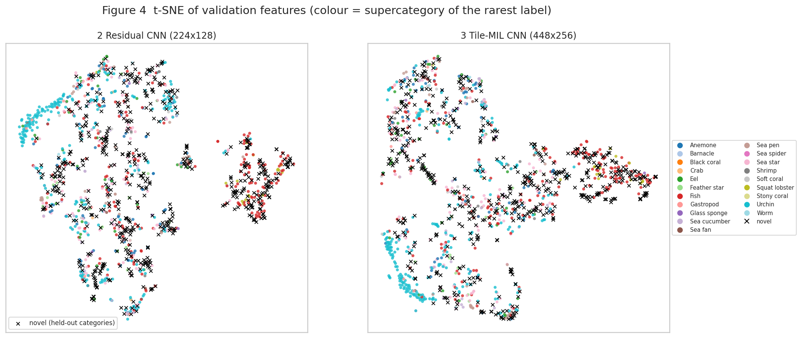<br><sub><b>Fig. 4</b> t-SNE of the validation features of both networks, coloured by the supercategory of each image's rarest label; novel images are crosses.</sub></td></tr>
<tr><td colspan="2" align="center">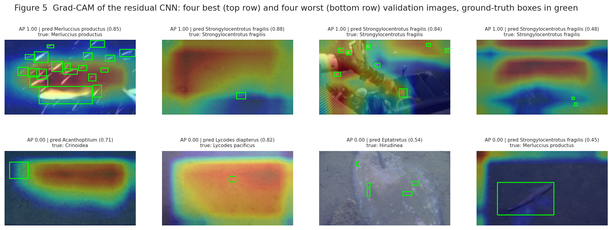<br><sub><b>Fig. 5</b> Grad-CAM of the residual CNN on the four best and four worst validation images with the ground-truth boxes in green: attention is broad and central rather than on the small animals, which the model identifies from global scene cues.</sub></td></tr>
<tr><td colspan="2" align="center">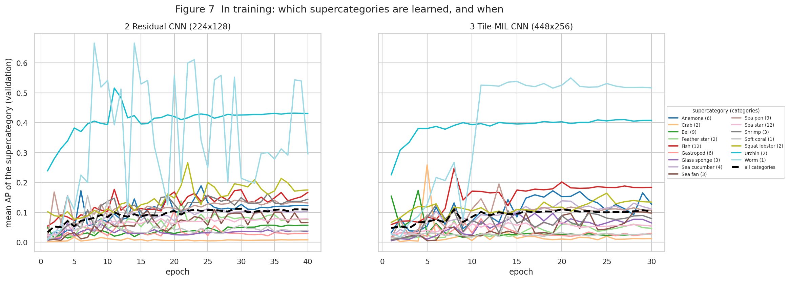<br><sub><b>Fig. 7</b> (in training) Mean AP of each supercategory per epoch. Source: <code>results/history/*.json</code>.</sub></td></tr>
<tr><td colspan="2" align="center">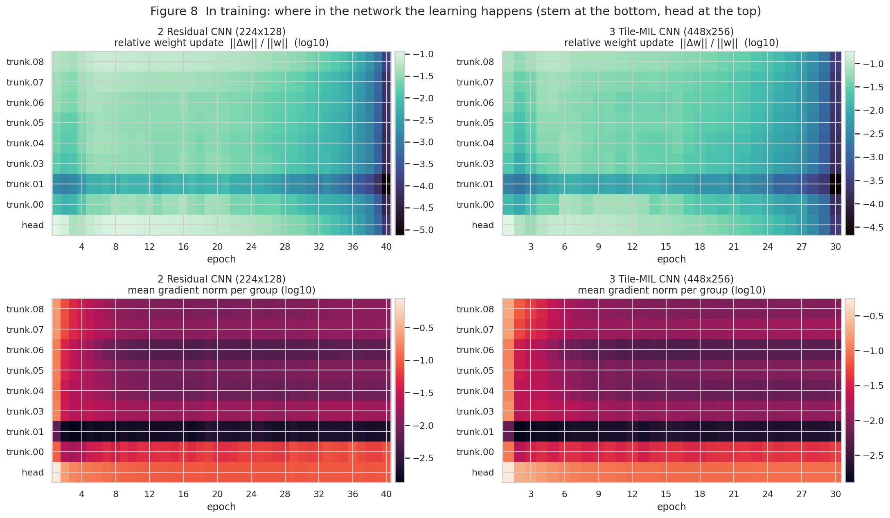<br><sub><b>Fig. 8</b> (in training) Relative weight update and mean gradient norm per layer group and epoch.</sub></td></tr>
<tr><td colspan="2" align="center">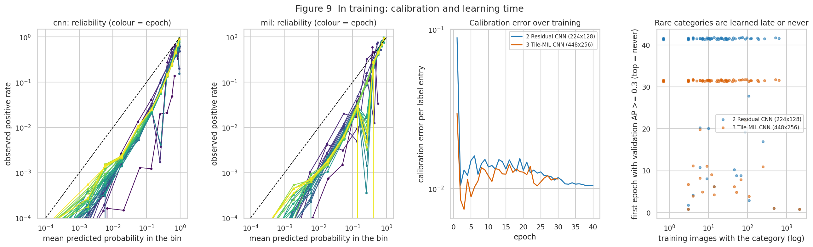<br><sub><b>Fig. 9</b> (in training) Reliability curves by epoch, calibration error, and the epoch at which each category first reaches AP 0.3 against its training frequency.</sub></td></tr></table>

## Out-of-sample case

A second round targets the out-of-sample half of the score (sAUC) and repairs three flaws of the validation proxy above: MAP@20 had been
computed on seen images only, selection and reporting used the same 550 novel images, and 54% of those novel images also show a seen
category. The score `0.5 (sAUC + MAP@20)` of the first attempt, recomputed with MAP@20 over **all** images, is 0.335 / 0.297 / 0.314
(not 0.43 / 0.39 / 0.40). The project's own floor was **0.55**.

**Data methodology.** Fourteen categories are held out and split into three disjoint sets: REPORT (the six categories of the first attempt,
550 images, read once), SELECT (4 categories, 204 images, used only to set the ranking-tail strength) and POOL (4 categories, 161 images,
used only by the learned combiner). The remaining 5,035 in-distribution images split into 4,279 training and 756 validation images
(checkpoint choice; negatives of every sAUC). A novel image is any image that shows a held-out category, and sAUC is also reported for
pure-novel and mixed images.

**Four from-scratch variants** on one 2.91 M-parameter residual CNN, three seeds each (details, equations and caveats in
[`fathomnet-2023-out-of-sample/README.md`](fathomnet-2023-out-of-sample/README.md#11-out-of-sample-case-four-variants-on-a-three-set-split)):
V1 virtual outliers drawn in the 2 to 3 sigma annulus around per-category hypersphere prototypes; V2 a radius head trained on mixtures of
images with disjoint label sets; V3 a Beta evidential head with sum-aggregated evidence; V4 a cross-fitted random-forest combiner over 15
post-hoc measures plus an outlier expert; a supercategory ranking tail for the 157 never-seen categories on all of them.

| Variant | Score | sAUC | MAP@20 seen / novel / all |
|---|---|---|---|
| **V0 control (1 - max probability)** | **0.402** (95% CI 0.368 to 0.432) | 0.327 | 0.722 / 0.140 / 0.477 |
| V4 learned combiner | 0.394 (0.359 to 0.423) | 0.310 | 0.722 / 0.140 / 0.477 |
| V1 hypersphere outliers | 0.303 (0.270 to 0.337) | 0.111 | 0.750 / 0.145 / 0.495 |
| V2 radius head | 0.231 (0.199 to 0.263) | 0.024 | 0.665 / 0.126 / 0.439 |
| V3 evidential sum | 0.171 (0.142 to 0.199) | -0.184 | 0.797 / 0.154 / 0.526 |

3-seed ensembles on REPORT ([`oos_results.json`](fathomnet-2023-out-of-sample/results/oos/oos_results.json)); seed half-ranges 0.02 to 0.03.

**Read this honestly.**
- **The 0.55 floor was not reached**; the best result is the plain control (0.402). None of the four novelty methods beats it: V1 to V3
  are worse on sAUC, V4 ties it within the seed band. The real gain of the round is all-image MAP@20, up from 0.38-0.42 to 0.44-0.53
  through longer, correctly selected training.
- MAP@20 on novel images stays at 0.13 to 0.15, and the ranking tail never helped (chosen strength 0 for every variant).
- The selection protocol was corrected after REPORT had been seen (a first run took the best of about ten scores on the small SELECT
  set; that was optimistic). The numbers shown come from the corrected protocol with scores fixed in advance, so they are not a clean
  first read. V4's out-of-fold SELECT sAUC (0.71) is inflated because folds share categories; its REPORT figure is the valid one.
- A proxy only: six held-out categories from the same depth range stand in for the real 800 to 1300 m shift.

### Visualizations (out-of-sample case)

Six result figures and three that read the statistics collected every epoch. Each caption names the file it comes from.

<table>
<tr><td width="50%">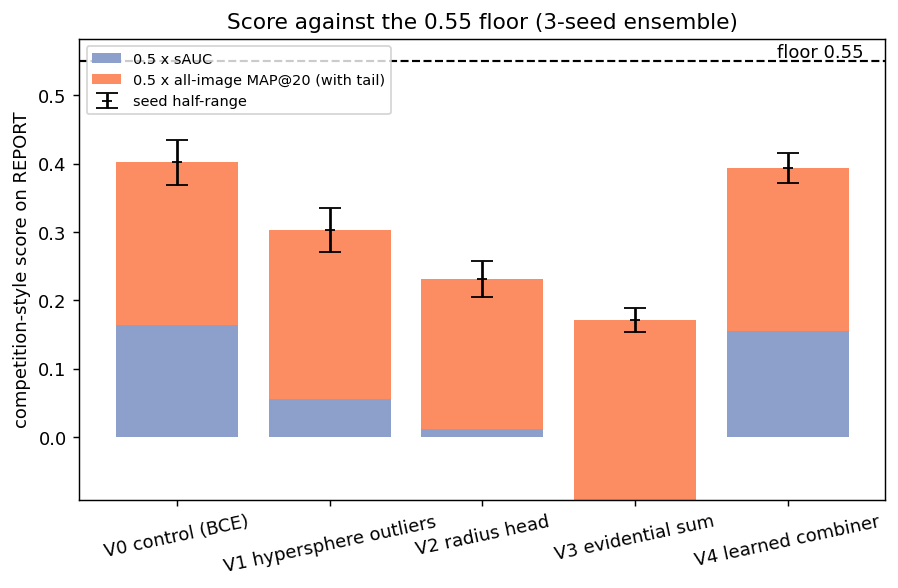<br><sub><b>Fig. 1</b> Competition-style score of each variant (3-seed ensemble) against the 0.55 floor, split into the two halves; bars below zero are a negative sAUC. Whiskers are the seed half-range. <i>Source: results/oos/oos_results.json</i></sub></td><td width="50%">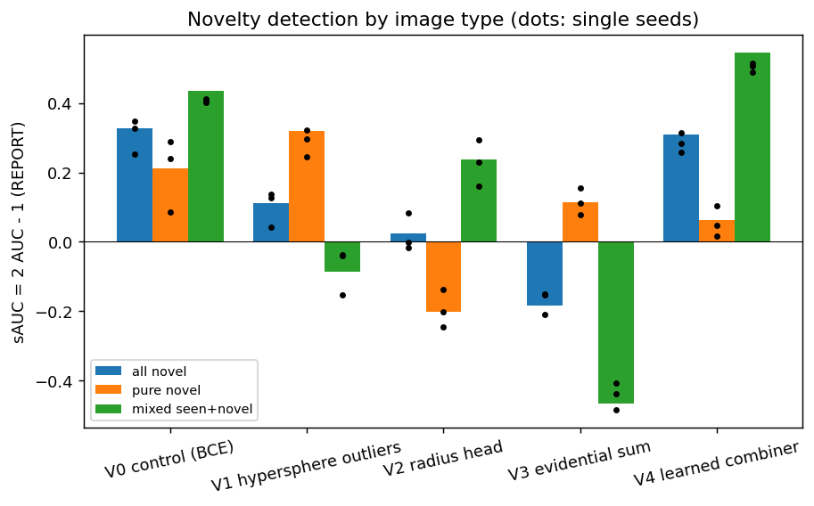<br><sub><b>Fig. 2</b> sAUC on REPORT for all novel images, pure-novel images and images that also show a seen category; dots are single seeds. <i>Source: results/oos/oos_results.json</i></sub></td></tr>
<tr><td width="50%">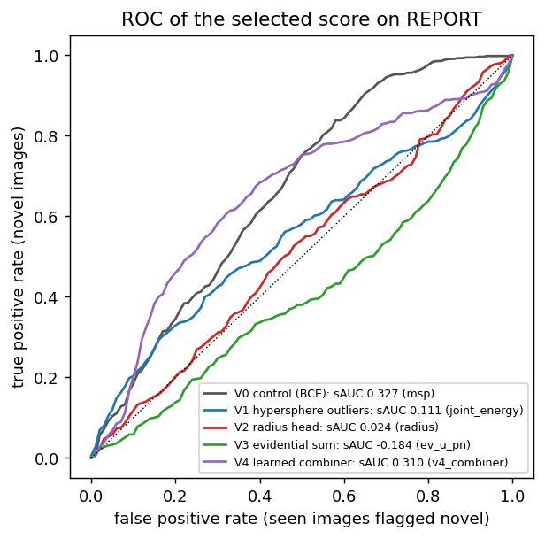<br><sub><b>Fig. 3</b> ROC curve of each variant's fixed novelty score on REPORT against ID validation. <i>Source: results/oos/oos_results.json</i></sub></td><td width="50%">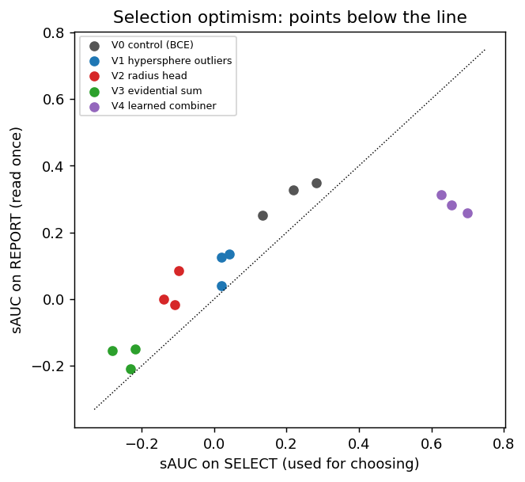<br><sub><b>Fig. 6</b> sAUC on SELECT (used for choosing) against REPORT (read once), per seed; points below the diagonal show selection optimism. <i>Source: results/oos/oos_results.json</i></sub></td></tr>
<tr><td colspan="2" align="center">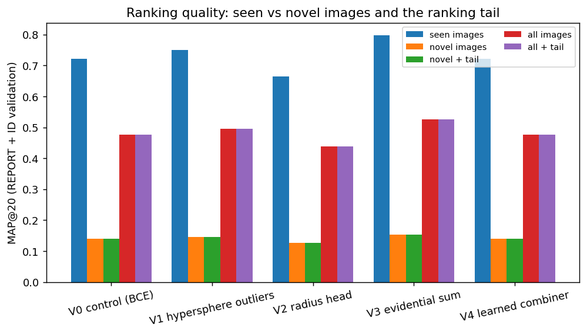<br><sub><b>Fig. 4</b> MAP@20 on seen images, novel images and all images, with and without the supercategory ranking tail (tau = 0 everywhere, so the tail changes nothing). <i>Source: results/oos/oos_results.json</i></sub></td></tr>
<tr><td colspan="2" align="center">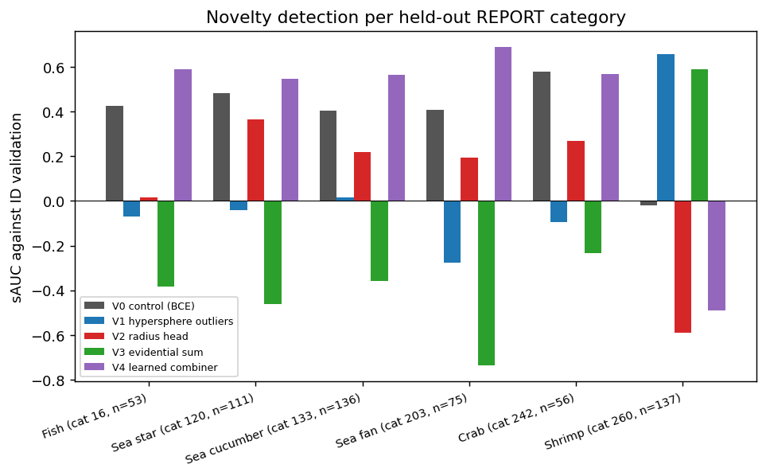<br><sub><b>Fig. 5</b> Novelty sAUC per held-out REPORT category (with its supercategory and image count). <i>Source: results/oos/oos_results.json</i></sub></td></tr>
<tr><td colspan="2" align="center">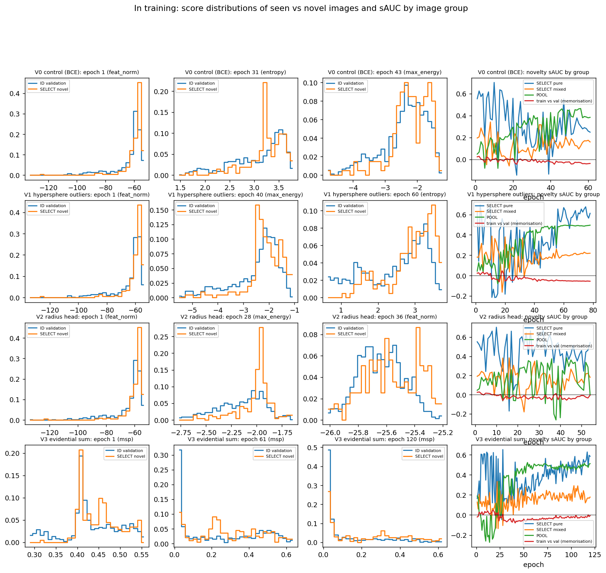<br><sub><b>Fig. 7</b> (in training) Novelty-score histograms of ID-validation and SELECT images at the first, a middle and the selected epoch, and sAUC by image group per epoch, including the train-versus-validation memorisation gap. The histogram score is the one with the highest SELECT sAUC at that epoch, a diagnostic only; the reported scores are fixed. <i>Source: results/oos/history/*_history.json</i></sub></td></tr>
<tr><td colspan="2" align="center">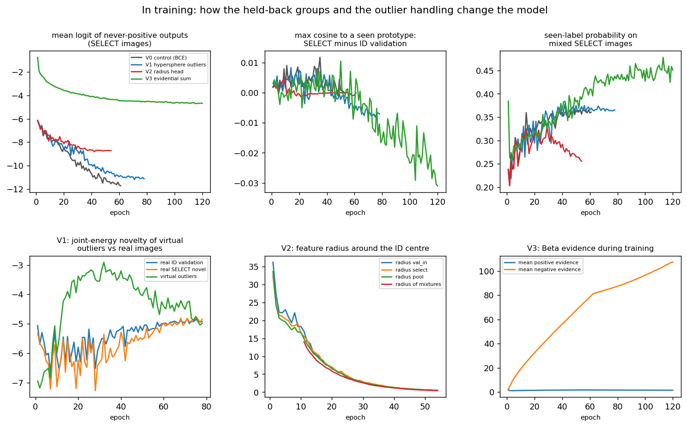<br><sub><b>Fig. 8</b> (in training) Behaviour of the never-positive outputs, distance to seen-category prototypes, seen-label probability on mixed images, V1 virtual outliers against real novel images, V2 radii and V3 evidence. <i>Source: results/oos/history/*_history.json</i></sub></td></tr>
<tr><td colspan="2" align="center">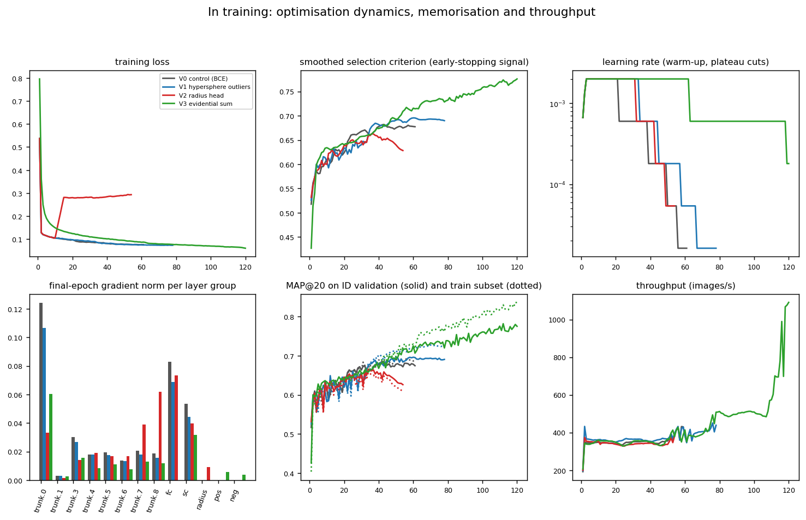<br><sub><b>Fig. 9</b> (in training) Loss, smoothed selection criterion, learning rate with plateau cuts, gradient norm per layer group, ID-validation MAP (solid) against a training subset (dotted) and throughput. <i>Source: results/oos/history/*_history.json</i></sub></td></tr>
</table>

## Reproduce

Needs Python 3.10+, PyTorch with torchvision, scikit-learn, seaborn, a Kaggle account that accepted the competition rules and the
Kaggle CLI. A GPU is used when present; the unit tests and a small pre-processing run work on CPU.

```bash
cd fathomnet-2023-out-of-sample
python3 tests/test_fn_common.py                      # 18 checks of the metrics and the split, ~seconds
kaggle competitions download fathomnet-out-of-sample-detection -p data && (cd data && unzip -oq *.zip)
python3 fetch_images.py train && python3 fetch_images.py eval     # resumable; re-run until complete
python3 preprocess.py                                # arrays, split and statistics -> prep/
python3 train_classical.py && python3 train_cnn.py cnn --epochs 40 --batch 128 && python3 train_cnn.py mil --epochs 30 --batch 64
python3 make_figures.py                              # tables and the nine figures
```

The out-of-sample round (section above) is reproduced by the commands in section 11.7 of the folder README. Details, design decisions and the file map are in [`fathomnet-2023-out-of-sample/README.md`](fathomnet-2023-out-of-sample/README.md).

## Data and licence

The images are **not** redistributed here: they are licensed CC BY-NC-ND 4.0 by FathomNet/MBARI and the competition rules forbid
passing the data to non-participants. `fetch_images.py` downloads them from the URLs in the competition annotation files. Please
acknowledge [FathomNet](https://fathomnet.org) and the [Monterey Bay Aquarium Research Institute](https://www.mbari.org).

## Candidate next experiments

Following the out-of-sample round, still **untested** here: category-grouped cross-fitting for the combiner, a higher epoch cap for the evidential head (it was still improving), and a novelty-aware checkpoint criterion. From the first attempt:

- class-balanced sigmoid loss for the 63 categories with five or fewer images (Cui et al., 2019);
- choosing learning rate and weight decay from the early parameter norm and dropping momentum (Brigato and Mougiakakou, 2023), noting that its precondition of full training accuracy is not met by these models;
- attention pooling over tiles in place of log-sum-exp (Ilse et al., 2018);
- coarse-to-fine heads over the 20 supercategories (Zhu and Bain, 2017; a supercategory head is used by the ranking tail of the out-of-sample round, without a measured gain);
- a normalised-logit loss or energy score for novelty detection (Wei et al., 2022; Liu et al., 2020), both defined for softmax outputs, so an extension to independent sigmoid outputs would be required.

## References

- Cui, Y., Jia, M., Lin, T.-Y., Song, Y., Belongie, S. *Class-Balanced Loss Based on Effective Number of Samples.* CVPR 2019.
- Brigato, L., Mougiakakou, S. *No Data Augmentation? Alternative Regularizations for Effective Training on Small Datasets.* ICCV Workshops 2023.
- Ilse, M., Tomczak, J., Welling, M. *Attention-based Deep Multiple Instance Learning.* ICML 2018.
- Zhu, X., Bain, M. *B-CNN: Branch Convolutional Neural Network for Hierarchical Classification.* arXiv:1709.09890, 2017.
- Wei, H., Xie, R., Cheng, H., Feng, L., An, B., Li, Y. *Mitigating Neural Network Overconfidence with Logit Normalization.* ICML 2022.
- Liu, W., Wang, X., Owens, J. D., Li, Y. *Energy-based Out-of-distribution Detection.* NeurIPS 2020.
- Peng, N. et al. *VMF-GOS: Geometry-guided virtual Outlier Synthesis for Long-Tailed OOD Detection.* 2026.
- Wang, Y., Qin, T., Valle, E., Abrahao, B. *BootOOD: Self-Supervised Out-of-Distribution Detection via Synthetic Sample Exposure under Neural Collapse.* 2025.
- Wang, H., Liu, W., Bocchieri, A., Li, Y. *Can multi-label classification networks know what they don't know?* NeurIPS 2021.
- Aguilar, E., Raducanu, B., Radeva, P. *Multi-label out-of-distribution detection via evidential learning.* 2025.
- Hogeweg, L. et al. *COOD: Combined out-of-distribution detection using multiple measures for anomaly and novel class detection in large-scale hierarchical classification.* 2024.
- Anudeep, A. S., Sundaresan, V. *MARVEL: Margin-Aware Robust von Mises-Fischer Expert Learning for Long-Tailed Out-of-Distribution Detection.* 2026.
- FGVC10 workshop, CVPR 2023: FathomNet 2023 competition, MBARI.
