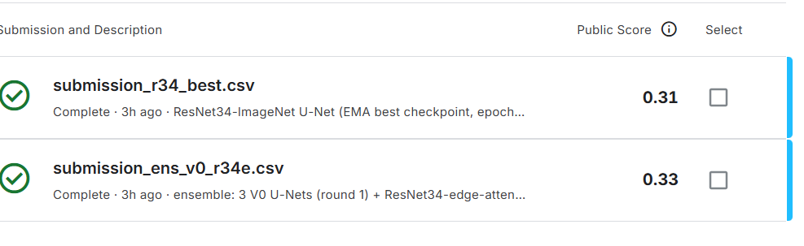

# Filament segmentation 2026: instance segmentation of thin solar structures

Instance segmentation of dark, thin, elongated filaments in 2048 x 2048 full-disk H-alpha images, scored by Panoptic Quality. In the
first round three small U-Net variants are trained from scratch and one pre-trained Mask2Former is fine-tuned; the second round
(section 12) adds ImageNet-pre-trained ResNet34 U-Nets, hysteresis instance recovery and probability-map ensembles, and submits to the
platform (best public score **0.33**). All runs share one pre-processing stage, one grouped split, tiled inference and one scoring path.
Summary, figures and references are in the [repository README](../README.md); this page is the method and the evidence.

## 1. The task and its metric

One polygon per filament; a submission row per predicted instance as a run-length-encoded 2048 x 2048 mask. Predictions are matched to
ground truth at IoU > 0.5 and scored by Panoptic Quality,

`PQ = sum IoU(matched pairs) / (|TP| + 0.5 |FP| + 0.5 |FN|) = SQ x RQ`,

with SQ the mean IoU of matched pairs and RQ = |TP| / (|TP| + 0.5 |FP| + 0.5 |FN|). The competition's Evaluation and Leaderboard pages
name PQ as the ranking metric; its Submission File page still says the scoreboard shows a mean Dice score. Which one the scoreboard
displays could not be established, so PQ is reported together with SQ, RQ and pixel Dice. Sections 1 to 11 describe the first round,
which made no submission; the second round (section 12) submitted twice and reports both public scores.

## 2. What the data look like (`investigate_data.py`, [`results/data_investigation.json`](results/data_investigation.json))

| Quantity | Value |
|---|---|
| Training images / test images | 707 / 180 JPEG files, 2048 x 2048, 8-bit grayscale |
| Annotation records | 1,154 (one, two or three annotator copies for 411 / 145 / 151 images), 8,199 single-piece polygons |
| Instances per record | median 7, up to 26; area median 1,228 px; long side of the box median 96 px |
| Structure width (distance transform) | median 10 px; per-record 10th percentile median 5.9 px |
| Touching instances | 1.6% of sampled records |
| Train / test shift | none visible: same 2011 to 2022 span, same six instrument codes in the file names |
| **Agreement of two annotators of one image** | **median PQ 0.359** (10th / 90th percentile 0.133 / 0.575, maximum 0.748; 400 of 598 pairs) |

The last row is the ceiling that matters: against one annotator's labels a score of 0.55 sits above what two annotators usually reach
on each other (median SQ 0.631, median RQ 0.571).

## 3. Pre-processing, split and inference (`prep_fil.py`, `fil_gpu.py`, `fil_infer.py`)

- **Pre-processing, once, on the GPU:** batched nvjpeg decode, fit of the solar disk, radial flattening of limb darkening (120 bins),
  local contrast normalisation at 20 px (computed at 1/4 resolution), 8-bit quantisation. The GPU path is tested against a CPU reference
  (`tests/test_fil_gpu.py`: correlation above 0.97).
- **Split by file** (annotator copies of one image always share a role), stratified by instrument code, seed 0: FIT 496 files / 821
  records, CHOOSE 105 / 169, REPORT 106 / 164. CHOOSE drives early stopping and checkpoint choice; REPORT is meant to be read once.
- **Training crops** of 512 x 512 at full resolution (70% centred near an annotated vertex), flips and 90-degree rotations.
- **Inference:** overlapping 512 px tiles (stride 384) blended with a Hann window; threshold 0.5, 8-connected components, components
  below 30 px removed (`instances_from_prob`); a grid over threshold, minimum area and closing radius is implemented in `fil_infer.py`
  but was **not run**, so the reported numbers use these defaults.

## 4. The four approaches

| Variant | Model | Loss | Parameters |
|---|---|---|---|
| V0 control | 4-stage U-Net, base 16, from scratch | BCE + soft Dice | 1.94 M |
| V1 | V0 | (1 - 0.3)(BCE + soft Dice) + 0.3 (1 - soft-clDice), 15 skeleton iterations | 1.94 M |
| V2 | V0 + two edge-guided self-attention blocks at the 1/16 bottleneck (edge map = sigmoid(conv3x3(input)) added to queries and keys) | BCE + soft Dice | 2.47 M |
| V3 | Mask2Former, Swin-tiny, COCO-instance checkpoint, one class, 100 queries | the model's mask-classification loss | 47.4 M |

V1 follows the soft-skeleton loss of Shit et al. (2021) with the base term changed from soft Dice to BCE + Dice; V2 follows the
edge-guided attention of Solomon et al. (2025) at a smaller width; V3 turns the queries into one probability map,
`p(x) = sum_q P(filament | q) sigmoid(mask_q(x))`, so that touching instances are separated only by the shared component step.
**V3 is the one pre-trained model in this repository**; the others use no pre-trained weights.

Optimisation: U-Nets use Adam, 3e-4, batch 8, a cosine schedule to 5% of the rate; V0 to V2 seed 0 ran a first 30-epoch cycle and then
two warm restarts at 1e-4 (60 epochs for V0, 52 for V1, 58 for V2); seeds 1 and 2 of V0 and V2 are single 60-epoch cycles. V3 uses
AdamW 1e-4 (backbone 0.1x), weight decay 0.05, batch 6, gradient clipping 1.0, and stopped at a 26-minute wall-clock budget after
9 epochs. Each run's recorded epoch time stays under 30 minutes.

## 5. Results (best checkpoint, CHOOSE monitoring subset)

[`results/run_summary.csv`](results/run_summary.csv); the monitoring subset is a fixed 16 CHOOSE records (12 for V3, a subset of the
16). **These are not REPORT scores**: REPORT was never read, so there is no held-out number here.

| Variant | Runs | Best smoothed PQ per seed | Mean PQ / SQ / RQ at the best checkpoint | Extra predictions per true instance | Missed per true instance |
|---|---|---|---|---|---|
| V0 U-Net | 3 seeds | 0.334 / 0.359 / 0.345 | 0.351 / 0.665 / 0.516 | 1.02 | 0.32 |
| V1 + soft-clDice | 1 seed | 0.312 | 0.321 / 0.651 / 0.492 | 1.09 | 0.36 |
| V2 + edge attention | 3 seeds | 0.346 / 0.342 / 0.342 | 0.350 / 0.681 / 0.512 | 1.00 | 0.34 |
| V3 Mask2Former | 1 seed, 9 epochs | 0.319 | 0.329 / 0.686 / 0.479 | 1.36 | 0.24 |

Pixel Dice on the subset is 0.63 to 0.66 for the U-Nets and 0.59 for V3. How to read it:

- **V0 and V2 are indistinguishable** (seed ranges 0.334 to 0.359 and 0.342 to 0.346). The edge-attention blocks and the extra
  parameters did not move PQ; V1's soft-clDice term scored lowest in its single seed and was never given more.
- **RQ, not SQ, limits the score.** Matched instances overlap well (SQ 0.65 to 0.69) but only about two thirds of true instances are
  matched, while each true instance comes with about one extra predicted instance (Post 2, Post 4).
- **Fragmentation is the dominant error** for the U-Nets: about 0.14 true instances per true instance are split, 0.03 merged
  (merging is rare because touching instances are rare). Recall falls to 0.50 to 0.58 for instances of 3,000 px and more, which are
  the ones broken into pieces (Post 5).
- **The pre-trained Mask2Former reached PQ 0.33 after 9 epochs** (about 1,200 steps), with higher recall on large instances (0.72) and
  fewer splits (0.09), but more extra predictions (1.36). It is competitive per unit of training, not better; with one seed on 12
  images this is a lead, not a result.
- **Against the human ceiling:** the mean PQ of 0.35 is close to the human-vs-human median of 0.36 and far below its 90th percentile
  (0.58); per-image PQ of the best checkpoints spans 0.13 to 0.56 (Post 1, Post 3).
- The probability maps are confident (mean 0.70 inside a filament, 0.005 outside) and PQ is insensitive to the threshold between 0.3
  and 0.7 (Fig. 5), so the errors are in instance structure, not in thresholding.

### 5.1 First pass: 30 epochs

The first cosine cycle (seed 0, [`results/first_pass_30_epochs.csv`](results/first_pass_30_epochs.csv)) ended at best smoothed PQ 0.295
(V0), 0.200 (V1) and 0.305 (V2); V3 stopped at 0.319 after 9 epochs. At that point training Dice was only about 0.70 and the loss was
still falling, which is why the U-Nets were trained further. A statistics snapshot taken during the continuation is analysed in
[`results/first_pass_analysis.txt`](results/first_pass_analysis.txt) (trajectories, size recall, gradient and update ratios by layer
group). The continuation (30 more epochs, 22 for V1) moved V0 and V2 by about 0.04 and V1 by about 0.11.

## 6. Figures

Six in-training figures ([`make_figures_fil.py`](make_figures_fil.py)) and five post-training figures
([`make_posthoc_figures_fil.py`](make_posthoc_figures_fil.py)), all drawn from the files in `results/`; they are embedded with captions in
the [repository README](../README.md#filament-segmentation-2026).

## 7. Compute

One NVIDIA L4 (22 GiB), several jobs sharing it. Pre-processing of the 887 images takes about 40 s. A U-Net epoch of 102 steps takes a
median of 23 to 33 s (25 to 35 images per second) while sharing the GPU; a Mask2Former epoch of 136 steps takes about 90 s. The recorded
epoch time of every run is 24 to 30 minutes (26.5 for V3); the per-run table in `results/run_summary.csv` holds the epochs and scores.

## 8. Tests (`tests/`)

| File | Checks |
|---|---|
| `test_fil_common.py` | PQ on known cases including split and merge, relations, instance recovery, RLE round-trip at 2048 x 2048, grouped split (a per-record split is caught), preprocessing |
| `test_fil_models.py` | shapes, gradients through the edge branch, soft skeleton, soft-clDice (a swapped definition is caught), loss weights, tiling |
| `test_fil_m2f.py` | parameter groups, probability combination, loss decreases on a toy batch, empty targets (needs `transformers` and the public checkpoint) |
| `test_fil_gpu.py` | nvjpeg decode and GPU pre-processing against the CPU reference (needs a CUDA device and the data) |
| `test_fil_post.py` | second round (9 checks): with default settings the new recovery equals the first-round one; the confidence, hysteresis and area filters on planted objects; averaging identical maps; tile stitching; ResNet34 U-Net shapes; EMA against a hand computation; the false-positive audit |

## 9. Limitations

- **No held-out score.** Selection and every number above come from a 12 to 16 image monitoring subset of CHOOSE; REPORT (106 images)
  was not scored, and instance parameters were not tuned. A smoothed criterion over about 20 evaluations on 16 images is noisy:
  consecutive evaluations differ by up to 0.14 early in a run and by about 0.02 on average near the end.
- **One seed for V1 and V3**, three for V0 and V2; no seed ensemble was evaluated.
- Seeds 1 and 2 were trained with a different schedule from seed 0, and V1 stopped at 52 epochs; the runs are not equal-budget.
- The metric shown on the platform scoreboard (PQ or Dice) is unresolved, and the local PQ scores against one annotator at a time.
- V3 used a pre-trained checkpoint and got far fewer steps; its comparison with the U-Nets is not like for like.

## 10. Files

| Path | Role |
|---|---|
| `fil_common.py` | records, grouped split, rasterisation, pre-processing, PQ and relations, instance recovery, RLE |
| `fil_models.py`, `fil_m2f.py` | U-Net, edge-guided attention, losses; Mask2Former wrapper |
| `fil_gpu.py`, `prep_fil.py` | GPU pre-processing and the pre-processing stage |
| `train_fil.py`, `fil_infer.py`, `make_submission_fil.py` | training, tiled inference and scoring, submission writer |
| `investigate_data.py`, `analyze_round1.py`, `summarize_runs.py` | data investigation, statistics analysis, result tables |
| `make_figures_fil.py`, `make_posthoc_figures_fil.py` | the eleven figures |
| `results/` | run table, first-pass table, per-run training statistics and example crops, data investigation |
| `fil_pre.py`, `train_fil2.py` | second round: ResNet34 U-Net (with optional edge attention), weight EMA, training of the four new variants |
| `fil_post.py`, `fil_audit.py` | second round: hysteresis and confidence-filtered instance recovery, map averaging, false-positive audit |
| `predict_choose.py`, `score_fixed.py`, `submit_best.py` | second round: CHOOSE probability maps, fixed-setting scoring of candidates, test-set submission |
| `make_figures_fil2_pub.py`, `make_posthoc_figures_fil2_pub.py` | second round: six in-training and five post-training figures |
| `results/loop2/` | second round: per-run statistics, run and candidate tables, GPU utilisation samples, submission record |

## 11. Reproduce

```bash
pip install numpy scipy pillow torch torchvision matplotlib pycocotools transformers kaggle
python3 tests/test_fil_common.py && python3 tests/test_fil_models.py       # seconds, no data needed
kaggle competitions download -c filament-segmentation-2026 && unzip -q filament-segmentation-2026.zip -d data
python3 investigate_data.py --root data/MAGFiLO_1.0_Kaggle_2026
python3 prep_fil.py --root data/MAGFiLO_1.0_Kaggle_2026 --out prep          # GPU decode and transform, then labels
python3 train_fil.py --variant v0 --seed 0 --prep prep --out runs --crop 512 --bs 8 --base 16 --epochs 30 --cosine-epochs 30 --min-epochs 30
python3 train_fil.py --variant v3 --seed 0 --prep prep --out runs --crop 512 --bs 6 --lr 1e-4 --epochs 1000 --time-budget-min 26
python3 fil_infer.py --run runs/v0_s0 --prep prep                          # CHOOSE scoring and instance-parameter grid
python3 summarize_runs.py && python3 make_figures_fil.py && python3 make_posthoc_figures_fil.py
```

The tables and figures in this folder are regenerated from `results/runs/` by the last line without any data.

## 12. Second round: pre-trained encoders, ensembles and two platform scores

### 12.1 What changed and why

The first round left three facts: false positives dominated (about one extra instance per true one), the U-Nets were under-fitted
(training Dice 0.70, loss still falling), and the pre-trained Mask2Former reached the U-Nets' level after 9 epochs. The second round
therefore changes the initialisation, the instance recovery and the way models are combined, and keeps the split, the pre-processing and
the scoring code of the first round unchanged.

| Variant | Model | Training |
|---|---|---|
| `r34` | U-Net with an ImageNet ResNet34 encoder (first-layer filters summed to one grey channel), transposed-conv decoder with GroupNorm, a last block at full resolution that also sees the input; 24.4 M parameters | BCE + soft Dice, Adam 3e-4 (encoder 0.33x), batch 8, 512 crops, EMA of weights (0.995) |
| `r34e` | `r34` + the two edge-guided attention blocks of V2 at the 1/32 bottleneck; 26.5 M | as `r34` |
| `r34c` | `r34` trained on the soft consensus (mean) of the annotator copies of each image | as `r34` |
| `m2fx` | the first-round Mask2Former checkpoint, continued | its own loss, batch 4 |

The encoder transfer follows TernausNet (Iglovikov and Shvets, 2018); the lower encoder rate follows the fine-tuning guidance of He et
al. (2019). Seed 0 of the three ResNet34 variants ran two cosine cycles at 3e-4 (about 12 and 30 epochs), then was resumed at 2e-4 with a
third cosine cycle over 80 epochs and early stopping (patience 6 evaluations of the smoothed criterion, one evaluation every 3 epochs on
the 16-record monitoring subset), with no wall-clock limit.

**Instance recovery** (`fil_post.instances_post`): hysteresis (a component of `p > lo` survives only if it contains a pixel with
`p > hi`), then removal of components below `min_area` pixels or below `min_conf` mean probability. One setting was fixed for every
candidate and **not searched**: `hi 0.4, lo 0.2, min_conf 0.8, min_area 200`, no closing.

**Ensembles** average the probability maps of several runs before instance recovery. Candidates were scored on 80 CHOOSE records
(`score_fixed.py`); REPORT was still never read.

### 12.2 Training results (16-record monitoring subset)

[`results/loop2/loop2_runs.csv`](results/loop2/loop2_runs.csv)

| Run | Epochs | Best epoch | Best smoothed PQ | Median s / epoch (shared L4) | Peak memory |
|---|---|---|---|---|---|
| `r34_s0` | 80 | 75 | **0.409** | 57 | 5.6 GiB |
| `r34e_s0` | 69 (early stop) | 51 | 0.389 | 68 | 5.8 GiB |
| `r34c_s0` | 79 | 69 | 0.381 | 57 | 5.6 GiB |
| `r34e_s1` | 35 (stopped) | 24 | 0.375 | 75 | 5.0 GiB |
| `m2fx_s0` | 2 | 2 | 0.321 | 296 | 6.3 GiB |

With a pre-trained encoder and longer training (the two are not separated) the best monitoring PQ rises from 0.33 to 0.36
(first-round U-Nets) to 0.375 to 0.409. The consensus target
(`r34c`) and the edge attention (`r34e`) did not beat the plain `r34` in their single comparable seed. Continuing Mask2Former got only
2 epochs before the round was stopped.

### 12.3 Candidates on 80 CHOOSE records and the public scores

[`results/loop2/loop2_candidates.csv`](results/loop2/loop2_candidates.csv); one fixed instance setting for all rows.

| Candidate | Models averaged | PQ | SQ | RQ | TP / FP / FN | Public score |
|---|---|---|---|---|---|---|
| V0 x3 + `r34_s0` best | 4 | **0.431** | 0.669 | 0.635 | 427 / 266 / 233 | not submitted |
| V0 x3 + `r34e_s0` (epoch 51) | 4 | 0.427 | 0.665 | 0.632 | 424 / 237 / 236 | **0.33** |
| V0 x3 + `r34`, `r34e`, `r34c` | 6 | 0.424 | 0.660 | 0.624 | 425 / 247 / 235 | |
| `r34`, `r34e`, `r34c` | 3 | 0.417 | 0.667 | 0.615 | 431 / 271 / 229 | |
| V0 x3 (first round) | 3 | 0.412 | 0.669 | 0.611 | 441 / 309 / 219 | |
| `r34e_s0` (epoch 51) | 1 | 0.395 | 0.671 | 0.587 | 457 / 409 / 203 | |
| `r34c_s0` | 1 | 0.387 | 0.671 | 0.572 | 457 / 456 / 203 | |
| V0 seed 0 (first round) | 1 | 0.387 | 0.668 | 0.577 | 459 / 439 / 201 | |
| `r34_s0` (last epoch) | 1 | 0.385 | 0.670 | 0.570 | 461 / 463 / 199 | |
| `r34_s0` best (epoch 75) | 1 | 0.385 | 0.675 | 0.565 | 466 / 494 / 194 | **0.31** |



How to read it:
- **Averaging is the largest gain:** +0.03 to +0.05 PQ over any single model, almost all of it in RQ. False positives fall from 410 to
  490 to 240 to 310, at a cost of 20 to 40 true positives (Post 3). SQ stays at 0.66 to 0.68 throughout (Post 2).
- **On 80 records the single models are within 0.01 of each other** (0.385 to 0.395), although the 16-record monitoring subset had
  ranked `r34` clearly first. The pre-trained encoder helps mostly as a member of an ensemble with the first-round models.
- **The public scores are 0.10 below CHOOSE** for the ensemble (0.427 to 0.33) and 0.08 for the single model (0.385 to 0.31); the
  ensemble's advantage of about 0.04 survives on the public set as 0.02 (Post 5). Possible reasons, none of them tested: the candidate
  was the best of eight on the same 80 records (selection optimism), the public test images or their annotators differ from CHOOSE,
  and the platform's scoring rule may differ in detail from the local PQ. The public score is computed on part of the test set and shown
  to two decimals.
- **The 0.55 target is not reached.** The best public score is 0.33; the best offline PQ (0.431) is above the human-vs-human median
  (0.359) but far from 0.55.

### 12.4 Figures

Six in-training figures ([`make_figures_fil2_pub.py`](make_figures_fil2_pub.py), from `results/loop2/runs/*/history.json` and
`results/loop2/gpu_utilisation.json`) and five post-training figures ([`make_posthoc_figures_fil2_pub.py`](make_posthoc_figures_fil2_pub.py),
from the two tables), embedded in the [repository README](../README.md#filament-segmentation-2026). The in-training figures use seed 0 of
each variant; `r34e_s1` is left out because its 35 epochs would cut the seed mean short. The example crops of the first round's Fig. 6
were not kept for this round, so Fig. 6 shows the GPU footprint instead.

### 12.5 Limitation: small-scale training on one L4

Everything in this folder was trained on **one NVIDIA L4 (24 GB, 22.5 GiB usable), shared by up to six jobs at once**. That budget,
not the method, set most of the design:

- **Model and input size.** ResNet34 is the largest encoder trained; crops are 512 x 512 from 2048 x 2048 images, batch 8, so a model
  never sees a whole filament system or the full disk at once. Larger encoders, larger crops or full-resolution context were not tried.
- **Seeds and schedules.** One seed per variant in the comparison (a second `r34e` seed was stopped at 35 epochs), so differences of
  0.01 between single models are not resolved. A ResNet34 epoch takes about 57 to 68 s when shared (12 to 14 images per second), so an
  80-epoch run costs about 1.4 hours.
- **Mask2Former was starved.** At 296 s per epoch when shared, and restarted at batch 4 after an out-of-memory failure on the shared
  card, it received 9 + 2 epochs in total.
- **Memory headroom.** The pooled jobs peaked at 22.0 of 22.5 GiB (Fig. 6); jobs were started while their measured memory fitted, and
  one over-start had to be cut back.
- **No search.** Instance parameters were fixed, not tuned; no test-time augmentation was used, and only two submissions were made.
- The utilisation samples cover the first 107 minutes of pooled training (mean 89%, 89% of samples at or above 85%); the resumed
  training afterwards was not sampled.

Whether more compute would close the gap to 0.55 is **untested**; the annotator agreement (median PQ 0.36 between two copies of one
image) suggests that label noise, not only model size, bounds the score.

### 12.6 Reproduce the second round

```bash
python3 tests/test_fil_post.py                                                 # 9 checks, CPU, no data
python3 train_fil2.py --variant r34 --seed 0 --prep prep --out runs           # also r34e, r34c; m2fx with --init-from runs/v3_s0/best.pt
python3 train_fil2.py --variant r34 --seed 0 --prep prep --out runs --resume --cosine-offset 44 --cosine-epochs 80 --patience 6
python3 predict_choose.py --runs runs/v0_s0 runs/v0_s1 runs/v0_s2 runs/r34e_s0 --prep prep --out probs
python3 score_fixed.py --prep prep --files probs/files.json --params '{"hi":0.4,"lo":0.2,"min_conf":0.8,"min_area":200,"close_radius":0}' \
    --src ens=probs/v0_s0.npy,probs/v0_s1.npy,probs/v0_s2.npy,probs/r34e_s0.npy
python3 submit_best.py --runs runs/v0_s0 runs/v0_s1 runs/v0_s2 runs/r34e_s0 --prep prep \
    --params '{"hi":0.4,"lo":0.2,"min_conf":0.8,"min_area":200,"close_radius":0}' --out submission.csv
python3 make_figures_fil2_pub.py --runs results/loop2/runs --gpu results/loop2/gpu_utilisation.json --out figures/loop2
python3 make_posthoc_figures_fil2_pub.py --results results/loop2 --out figures/loop2
```

The last two lines redraw the eleven second-round figures from `results/loop2/` without any data or GPU.
